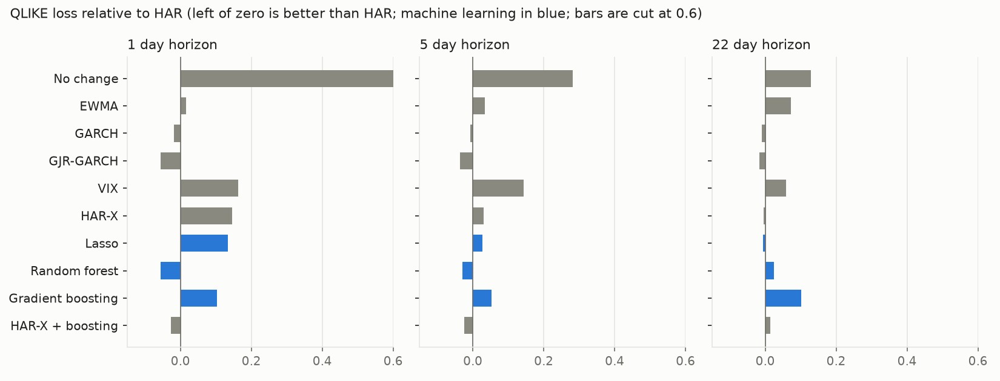

# Does machine learning beat HAR at forecasting volatility?

[](https://github.com/rxj0102/Volatility-Forecast-HAR/actions/workflows/ci.yml)

**Question.** HAR (Corsi 2009) forecasts variance from three numbers: yesterday's, last week's and last month's. Do lasso, random forest and gradient boosting, given the same information plus the VIX and a leverage term, forecast US equity variance better out of sample?

<!-- headline:start (generated by scripts/render_readme.py, do not edit by hand) -->
**Answer, on 6725 out-of-sample days from 2000 to 2026: sometimes, and it is the wrong comparison.** A random forest has a lower QLIKE loss than HAR at 1 and 5 days (Diebold-Mariano t = -5.7 and -2.9) but not at 22 days, and not under squared error at any horizon. Gradient boosting has a higher QLIKE loss than HAR at every horizon. The lasso beats HAR under squared error at 1 and 5 days and loses to it under QLIKE. The model that matters is an old one. GJR-GARCH, a four-parameter model from 1993 in which falling prices raise variance more than rising ones, beats HAR at 1 and 5 days (t = -6.7 and -4.7). The random forest matches it at 1 day and no machine learning model is significantly better than it at any horizon. What HAR lacks is the asymmetry, not flexibility.
<!-- headline:end -->

Every number on this page is written by `scripts/reproduce.py`, and CI fails if the page and the results file disagree.



## Results

<!-- results:start (generated by scripts/render_readme.py, do not edit by hand) -->
Daily data 1990-01-02 to 2026-09-30 (9254 days). Every model is refitted each January on earlier data only; forecasts start in 2000. QLIKE is shown relative to HAR, so negative is better than HAR. t is the Diebold-Mariano statistic against HAR with Newey-West errors; beyond about 2 in either direction is significant at 5%.

**1 day horizon** (6725 forecasts, 2000-01-03 to 2026-09-29)

| Model | QLIKE vs HAR | t (QLIKE) | MSE vs HAR | t (MSE) | R squared | Forecasts floored |
|---|---|---|---|---|---|---|
| No change | +2.780 | +14.1 | +74.6% | +3.2 | -0.38 | 33.0% |
| EWMA | +0.016 | +1.6 | +2.4% | +1.2 | 0.19 | 0.1% |
| GARCH | -0.018 | -3.3 | -2.1% | -1.2 | 0.23 | 0.0% |
| GJR-GARCH | -0.056 | -6.7 | -6.6% | -2.5 | 0.26 | 0.0% |
| VIX | +0.162 | +5.4 | -3.2% | -1.4 | 0.23 | 20.8% |
| **HAR** | 0 | | 0 | | 0.21 | 0.0% |
| HAR-X | +0.145 | +5.1 | -4.7% | -2.1 | 0.25 | 16.3% |
| Lasso | +0.133 | +4.8 | -4.6% | -2.1 | 0.25 | 15.8% |
| Random forest | -0.057 | -5.7 | +0.7% | +0.2 | 0.20 | 0.0% |
| Gradient boosting | +0.102 | +2.7 | +1.4% | +0.4 | 0.20 | 0.9% |
| HAR-X + boosting | -0.027 | -1.9 | -3.8% | -1.5 | 0.24 | n/a |

**5 day horizon** (6721 forecasts, 2000-01-03 to 2026-09-23)

| Model | QLIKE vs HAR | t (QLIKE) | MSE vs HAR | t (MSE) | R squared | Forecasts floored |
|---|---|---|---|---|---|---|
| No change | +0.281 | +8.9 | +18.4% | +1.1 | 0.29 | 5.7% |
| EWMA | +0.033 | +2.7 | +10.8% | +1.7 | 0.33 | 0.1% |
| GARCH | -0.006 | -1.4 | -0.2% | -0.1 | 0.40 | 0.0% |
| GJR-GARCH | -0.036 | -4.7 | -9.8% | -1.9 | 0.46 | 0.0% |
| VIX | +0.144 | +4.6 | -1.2% | -0.2 | 0.41 | 11.9% |
| **HAR** | 0 | | 0 | | 0.40 | 0.0% |
| HAR-X | +0.030 | +1.7 | -10.0% | -2.9 | 0.46 | 4.5% |
| Lasso | +0.027 | +1.5 | -9.5% | -2.8 | 0.46 | 4.4% |
| Random forest | -0.029 | -2.9 | +10.8% | +1.1 | 0.33 | 0.0% |
| Gradient boosting | +0.053 | +1.7 | +7.3% | +0.8 | 0.36 | 0.3% |
| HAR-X + boosting | -0.024 | -2.0 | -5.0% | -1.0 | 0.43 | n/a |

**22 day horizon** (6704 forecasts, 2000-01-03 to 2026-08-28)

| Model | QLIKE vs HAR | t (QLIKE) | MSE vs HAR | t (MSE) | R squared | Forecasts floored |
|---|---|---|---|---|---|---|
| No change | +0.129 | +4.1 | +35.4% | +1.6 | 0.03 | 0.4% |
| EWMA | +0.073 | +2.3 | +15.5% | +1.6 | 0.17 | 0.1% |
| GARCH | -0.010 | -1.2 | +0.4% | +0.1 | 0.28 | 0.0% |
| GJR-GARCH | -0.017 | -1.6 | -4.8% | -0.9 | 0.32 | 0.0% |
| VIX | +0.059 | +1.7 | -5.7% | -0.6 | 0.32 | 1.3% |
| **HAR** | 0 | | 0 | | 0.28 | 0.0% |
| HAR-X | -0.004 | -0.3 | -5.2% | -1.2 | 0.32 | 0.0% |
| Lasso | -0.007 | -0.5 | -5.1% | -1.1 | 0.32 | 0.0% |
| Random forest | +0.024 | +1.1 | +10.1% | +0.6 | 0.21 | 0.0% |
| Gradient boosting | +0.102 | +2.5 | +15.0% | +0.9 | 0.17 | 0.1% |
| HAR-X + boosting | +0.014 | +0.8 | +0.4% | +0.0 | 0.28 | n/a |

**Machine learning against GJR-GARCH** (QLIKE, Diebold-Mariano t; negative favours the machine learning model). This comparison was added after the first run showed which model was the one to beat.

| Model | 1 day | 5 day | 22 day |
|---|---|---|---|
| Lasso | +6.7 | +3.5 | +0.9 |
| Random forest | -0.1 | +0.5 | +2.1 |
| Gradient boosting | +4.0 | +2.7 | +3.0 |

**By period, 5 day horizon**: QLIKE relative to HAR

| Model | 2000-2007 | 2008-2009 | 2010-2019 | 2020 | 2021-2026 |
|---|---|---|---|---|---|
| GJR-GARCH | -0.054 | -0.060 | -0.036 | +0.145 | -0.033 |
| HAR-X | +0.027 | -0.022 | +0.064 | -0.009 | +0.001 |
| Random forest | -0.027 | +0.135 | -0.047 | -0.060 | -0.053 |
| Gradient boosting | +0.249 | +0.160 | -0.056 | -0.041 | -0.050 |
<!-- results:end -->

## Reading the results

- **The ranking depends on the loss, and that is informative.** QLIKE punishes a forecast that is too low much more than one that is too high. Squared error is dominated by a few crisis days. The linear models with VIX (HAR-X, lasso) do well on squared error and badly on QLIKE because a regression in levels sometimes forecasts a variance near zero on calm days. The last column shows how often that happened.
- **Asymmetry is what pays.** GJR-GARCH differs from plain GARCH by one parameter that lets a fall in prices raise variance more than a rise. That one parameter is worth more than the move from HAR to any machine learning model here.
- **The random forest earns its result honestly but narrowly.** It beats HAR under QLIKE at short horizons, ties GJR-GARCH at one day, and gives the gain back at 22 days and under squared error. In 2008 to 2009 it is clearly worse than HAR.
- **Gradient boosting needs more data than it had.** It is far worse than HAR in the 2000s, when it was trained on ten to twenty years of a very noisy target, and slightly better than HAR since 2010. Over the whole period it loses.
- **GJR-GARCH has one bad period,** 2020, when variance jumped faster than its recursion could follow.
- **R squared is low on purpose.** A squared daily return is a very noisy reading of that day's variance, so no forecast can explain much of it. The earlier version of this project reported an R squared above 0.7; that came from a target that overlapped its own inputs, as explained below.

## Design

| Choice | What and why |
|---|---|
| Target | Average squared daily log return of the US market over the next 1, 5 or 22 trading days. It never overlaps the data the forecast uses. |
| Features | Squared return today, its 5 and 22 day means, squared VIX, and today's squared return if negative. All known at the close. |
| Models | No change, EWMA (0.94), GARCH, GJR-GARCH, a regression on VIX, HAR, HAR-X (HAR plus VIX and the negative-return term), lasso, random forest, gradient boosting, and the average of HAR-X and boosting. The three machine learning models see the HAR-X features. |
| Protocol | Expanding window. Every model is refitted each January on days whose target is already realised. Forecasts run from 2000. |
| Loss | QLIKE and squared error. Both rank variance forecasts correctly when the target is a noisy proxy (Patton 2011). |
| Test | Diebold-Mariano against HAR, Newey-West errors. |
| Floor | No forecast may be below the lowest EWMA variance seen in training. |
| Tuning | None on the test period. Lasso picks its penalty by time-ordered cross-validation inside each training window; the tree models use fixed settings. |

## What was wrong with the first version

- **The target overlapped its inputs.** It forecast tomorrow's 5 day rolling volatility, which shares four of its five days with today's value. Most of the fit was that overlap, and the fitted HAR weight on last week was 0.99.
- **There was no no-change benchmark,** which is the first thing an overlapping target needs.
- **One train and test split, about three years of test data.** The rebuild forecasts 26 years with yearly refits.
- **Its conclusion was that HAR wins.** With a proper target, HAR is beaten by an older model it was never compared with on equal terms.

## Limits

- Squared daily returns are a noisy proxy. Realized variance from intraday data would sharpen every comparison, and free intraday history is not available.
- One asset. The US market return comes from the Ken French library, VIX from FRED.
- The floor rule was changed once. A first run at the 5 day horizon used the 1st percentile of the training target, which left near-zero forecasts that dominated QLIKE. Rankings under squared error do not depend on the floor.
- The comparison against GJR-GARCH was added after seeing that it, not HAR, was the model to beat.
- The machine learning models get five features. More features or a different target transform could change their ranking; that was not explored, to avoid searching on the test period.

## Reproduce

```bash
pip install -r requirements.txt
python -m pytest -q                  # tests, a few seconds
python scripts/reproduce.py          # about 2 minutes, rewrites results/
python scripts/render_readme.py      # rewrites this page; --check compares only
```

Data are frozen in `data/snapshot/market_daily.csv`. `src/data/opendata.py` downloads them again from the Ken French Data Library and FRED.

## Layout

```
src/study.py              features, targets, models, walk-forward, tests
src/data/opendata.py      FRED and Ken French downloaders
scripts/reproduce.py      runs every horizon, writes results/
scripts/render_readme.py  writes this page from results/metrics.json
tests/test_study.py       look-ahead, GARCH recursion, loss and test checks
data/snapshot/            frozen daily returns and VIX, 1990 to 2026
```

## References

- Corsi, F. (2009). A simple approximate long-memory model of realized volatility. *Journal of Financial Econometrics* 7(2).
- Diebold, F. and Mariano, R. (1995). Comparing predictive accuracy. *Journal of Business and Economic Statistics* 13(3).
- Glosten, L., Jagannathan, R. and Runkle, D. (1993). On the relation between the expected value and the volatility of the nominal excess return on stocks. *Journal of Finance* 48(5).
- Patton, A. (2011). Volatility forecast comparison using imperfect volatility proxies. *Journal of Econometrics* 160(1).
